# PathWise - Dynamic Tourism Planning & Real-Time Budgeting

A full-stack **MERN** application that plans a day-wise trip from your interests and budget, then keeps re-planning as you spend money, change the budget, or the weather turns.

> **The specialty:** *Dynamic trip planning + real-time budget tracking.* Add an expense and the budget meter, charts and recommendations update instantly. Cross 80% and the app proposes cheaper swaps. Rain is forecast and it proposes indoor alternatives.

---

## Table of contents
1. [Features](#1-features) · 2. [Technology stack](#2-technology-stack) · 3. [Architecture](#3-architecture) · 4. [Installation](#4-installation) · 5. [Environment variables](#5-environment-variables) · 6. [MongoDB setup](#6-mongodb-setup) · 7. [Backend setup](#7-backend-setup) · 8. [Frontend setup](#8-frontend-setup) · 9. [How to run](#9-how-to-run) · 10. [Demo credentials](#10-demo-credentials) · 11. [API documentation](#11-api-documentation) · 12. [How the dynamic itinerary works](#12-how-the-dynamic-itinerary-works) · 13. [How real-time budgeting works](#13-how-real-time-budgeting-works) · 14. [Testing](#14-testing) · 15. [Screenshots](#15-project-screenshots) · 16. [Future enhancements](#16-future-enhancements) · 17. [Troubleshooting](#17-troubleshooting)

---

## 1. Features

**Travelers**
- Register / login / logout with persistent sessions (JWT in an `httpOnly` cookie)
- 5-step trip wizard: details → dates (auto-counts days) → budget (shows the daily budget) → interests → review
- Smart morning / afternoon / evening itinerary for every day, with image, rating, cost, distance, crowd level, best time and description per place
- **Dynamic itinerary** - budget alerts (>80%, >100%), weather alerts, replacement suggestions when a place is removed, automatic re-planning when the budget is lowered
- **Real-time budget tracking** - add / edit / delete expenses, budget meter and totals update with no refresh, milestone states at 50 / 75 / 90 / 100%+
- Analytics (Recharts): expense pie, estimated-vs-actual bar chart, spending-over-time line chart with budget line
- Explore Places with filters (destination, category, price, rating, crowd level), search, sorting, details and *Add to trip*
- Weather (current + forecast) and a map section (journey, stops, live OpenStreetMap)
- Trip details with Overview, Itinerary, Budget, Expenses, Weather, Map, Places and Dynamic Recommendations

**Admin**
- Dashboard with totals and charts (user growth, trips created, expense statistics, popular destinations)
- View users, trips and expenses; full **CRUD for tourist places**

**Quality**
- Responsive: desktop sidebar, mobile bottom navigation, tablet layouts
- Loading skeletons, empty states, error states with retry, toast feedback, inline form validation, a root error boundary
- Works fully **offline from paid APIs** (demo mode) and upgrades to live data when keys are provided

---

## 2. Technology stack

| Layer | Tech |
|---|---|
| Frontend | React 18, Vite, Tailwind CSS 3, React Router DOM 6, Axios, Lucide React, Recharts, React Hot Toast |
| Backend | Node.js, Express 4, MongoDB, Mongoose 8, JWT (`jsonwebtoken`), `bcryptjs`, `dotenv`, `cors` |
| Hardening | `helmet`, `express-rate-limit`, `express-validator`, `express-mongo-sanitize`, `cookie-parser` |
| External APIs (optional) | OpenWeatherMap (weather), OpenTripMap (places), OpenStreetMap Nominatim (geocoding) |

JavaScript only (no TypeScript), REST APIs, modular architecture.

---

## 3. Architecture

```
┌──────────────────────────┐   /api (cookie)   ┌───────────────────────────────────────────┐
│  React SPA (Vite)        │ ───────────────▶ │  Express API                              │
│  pages · components      │                   │  routes → validation → controllers        │
│  AuthContext · services  │ ◀─────────────── │          → services (business logic)      │
└──────────────────────────┘      JSON         │            ├ recommendationService (score)│
                                               │            ├ itineraryService  (planner)  │
                                               │            ├ budgetService     (states)   │
                                               │            ├ weatherService  ─┐ live /    │
                                               │            ├ placeService    ─┤ mock      │
                                               │            └ mapService      ─┘ fallback  │
                                               └───────────────────┬───────────────────────┘
                                                                   │ Mongoose
                                                           ┌───────▼────────┐
                                                           │    MongoDB     │
                                                           │ users trips    │
                                                           │ expenses places│
                                                           │ itineraries    │
                                                           └────────────────┘
```

Request flow: `route → express-validator → auth/role middleware → controller → service → Mongoose → JSON`. Errors flow to one central error handler that never leaks stack traces in production.

### Project structure
```
pathwise/
├── client/                      React + Vite + Tailwind
│   └── src/
│       ├── components/          ui primitives, BudgetRoute, ItineraryView, DynamicPanel, charts, modals …
│       ├── pages/               Login, Register, Dashboard, CreateTrip, Trips, TripDetails, Explore,
│       │   └── admin/           Expenses, Profile · AdminDashboard/Users/Trips/Places
│       ├── layouts/             AppLayout (sidebar + mobile nav), AuthLayout
│       ├── context/             AuthContext
│       ├── hooks/               useFetch
│       ├── services/            api.js (axios + endpoint modules)
│       ├── utils/               format.js, constants.js, budgetToast.js
│       ├── App.jsx  main.jsx
├── server/
│   ├── config/                  env.js, db.js
│   ├── controllers/             auth, trip, expense, place, weather, admin
│   ├── middleware/              auth (protect/authorize), validate, error
│   ├── models/                  User, Trip, Expense, Place, Itinerary
│   ├── routes/
│   ├── services/                recommendation, itinerary, budget, weather, place, map, trip
│   ├── seed/                    seed.js, places.js (156 places, 11 destinations)
│   ├── tests/smoke.js           89-check end-to-end API test
│   ├── utils/                   ApiError, asyncHandler, geo, dates, token
│   └── server.js
├── docs/screenshots/
├── docker-compose.yml           optional local MongoDB
└── package.json                 root scripts (dev, seed, build, test)
```

---

## 4. Installation

Prerequisites: **Node.js 18+** and **MongoDB** (local, Docker or Atlas - see [section 6](#6-mongodb-setup)).

```bash
cd pathwise
npm run install:all          # installs root, server and client dependencies
cp server/.env.example server/.env
# edit server/.env: set JWT_SECRET (see below) and MONGO_URI
```

Generate a strong secret:
```bash
node -e "console.log(require('crypto').randomBytes(48).toString('hex'))"
```

---

## 5. Environment variables

**`server/.env`** (the server refuses to start without a real `JWT_SECRET`)

| Variable | Default | Purpose |
|---|---|---|
| `PORT` | `5000` | API port |
| `NODE_ENV` | `development` | `production` hides error details and enables secure cookies |
| `MONGO_URI` | `mongodb://127.0.0.1:27017/pathwise` | MongoDB connection string |
| `JWT_SECRET` | *(required)* | Signs tokens - long random string |
| `JWT_EXPIRES_IN` | `7d` | Session length |
| `CLIENT_URL` | `http://localhost:5173` | Allowed CORS origin(s), comma-separated |
| `COOKIE_SECURE` / `COOKIE_SAME_SITE` | prod / `lax` | For a frontend on a different HTTPS domain use `true` / `none` |
| `OPENWEATHER_API_KEY` | *(blank)* | Live weather. Blank = demo weather |
| `OPENTRIPMAP_API_KEY` | *(blank)* | Live places for destinations not in the database |
| `USE_LIVE_GEOCODING` | `false` | `true` = unknown cities are geocoded via OpenStreetMap Nominatim (no key) |

**`client/.env`** (optional) - `VITE_API_URL` only if the API is on another origin. In development, Vite proxies `/api` to `localhost:5000`, so leave it empty.

---

## 6. MongoDB setup

Pick one:

- **Local install** - install MongoDB Community, start `mongod`; the default `MONGO_URI` works.
- **Docker** - `docker compose up -d` (uses the included `docker-compose.yml`).
- **MongoDB Atlas** - create a free cluster, add your IP to the access list, create a DB user, then set  
  `MONGO_URI=mongodb+srv://<user>:<password>@<cluster>.mongodb.net/pathwise`

Then load the demo data:
```bash
npm run seed
```
This **wipes** users, trips, expenses, itineraries and places and inserts 156 tourist places, 7 users, 16 trips (with generated itineraries) and 48 expenses. Dates are relative to *today*, so the demo always has an active trip. (It refuses to run with `NODE_ENV=production` unless you pass `--force`.)

---

## 7. Backend setup
```bash
cd server
npm install
cp .env.example .env     # then edit
npm run seed             # optional demo data
npm run dev              # nodemon on :5000   (or: npm start)
```

## 8. Frontend setup
```bash
cd client
npm install
npm run dev              # Vite on :5173, proxies /api -> :5000
npm run build            # production build into client/dist
```

---

## 9. How to run

**Development (one command, from the project root):**
```bash
npm run dev          # API on http://localhost:5000  +  web on http://localhost:5173
```
Open **http://localhost:5173**.

**Production-style single server:** build the client, then start Express - it serves the React build and the API from one origin.
```bash
npm run build
npm start            # http://localhost:5000
```

---

## 10. Demo credentials

| Role | Email | Password |
|---|---|---|
| Traveler | `user@pathwise.com` | `User@123` |
| Admin | `admin@pathwise.com` | `Admin@123` |

Other seeded travelers: `priya@`, `rahul@`, `ananya@`, `karthik@`, `sneha@pathwise.com` (all `User@123`).  
The login page has one-click buttons for the two main accounts.

**Suggested demo script (5 minutes)**
1. Sign in as the traveler → Dashboard shows the **Goa Beach Escape** at 87% with a budget alert.
2. Open the trip → **Dynamic recommendations**: budget alert + a rain alert for an outdoor stop, with one-click *Apply swap*.
3. **Itinerary** → *Remove* a place → replacement suggestions appear → *Add*.
4. **Add Expense** → watch Spent / Remaining / meter change instantly; open **Budget** for the charts.
5. **Edit Trip** → lower the budget → itinerary is re-planned.
6. **Create a trip** with the wizard → itinerary generated in seconds.
7. Sign in as admin → charts, users, trips, expenses and **tourist-place CRUD**.

---

## 11. API documentation

Base URL `http://localhost:5000/api`. Auth is the `pw_token` httpOnly cookie *or* `Authorization: Bearer <token>`. Errors: `{ "message": "...", "errors": [{ "field", "message" }] }`.

### Auth
| Method | Endpoint | Auth | Description |
|---|---|---|---|
| POST | `/auth/register` | - | `name, email, password, confirmPassword` → creates a **user** (role cannot be chosen) |
| POST | `/auth/login` | - | `email, password` → sets cookie, returns `{ user, token }` |
| POST | `/auth/logout` | - | Clears the cookie |
| GET | `/auth/me` | user | Current user |
| PUT | `/auth/me` | user | Update name / profile image |
| PUT | `/auth/password` | user | Change password |

### Trips (owner only)
| Method | Endpoint | Description |
|---|---|---|
| POST | `/trips` | Create trip **and generate itinerary** |
| GET | `/trips` | List my trips (status derived from dates) |
| GET | `/trips/stats/overview` | Dashboard numbers + recent trips |
| GET | `/trips/:id` | Trip with populated itinerary |
| PUT | `/trips/:id` | Edit; re-plans itinerary when budget decreases or destination/dates/travelers/interests change |
| DELETE | `/trips/:id` | Deletes trip, itinerary days and expenses |
| POST | `/trips/:id/itinerary/generate` | Regenerate. Body `{ "optimise": true }` = low-budget plan |
| PUT | `/trips/:id/itinerary` | `{ action: "remove" \| "replace" \| "add", day, itemId?, placeId?, slot? }` |
| GET | `/trips/:id/recommendations` | Dynamic engine: alerts, swaps, free options, tips |
| GET | `/trips/:id/recommended-places` | Places ranked by recommendation score |
| GET | `/trips/:id/analytics` | Category totals, estimated vs actual, timeline |
| GET | `/trips/:id/map` | Route distance/time + planned stops |

### Expenses
| Method | Endpoint | Description |
|---|---|---|
| POST | `/expenses` | `tripId, category, description, amount, date` → returns the **fresh budget** |
| GET | `/expenses/:tripId` | Expenses of a trip |
| GET | `/expenses` | All my expenses |
| PUT | `/expenses/:id` | Edit (budget recalculated) |
| DELETE | `/expenses/:id` | Delete (budget recalculated) |

Categories: `Accommodation, Food, Transportation, Activities, Shopping, Other`.

### Places & weather
| Method | Endpoint | Auth | Description |
|---|---|---|---|
| GET | `/places` | user | Filters: `destination, category, minPrice, maxPrice, rating, crowdLevel, q, sort, page, limit` |
| GET | `/places/destinations` | user | Destination list |
| GET | `/places/:id` | user | One place |
| POST / PUT / DELETE | `/places`, `/places/:id` | **admin** | Place CRUD |
| GET | `/weather/:destination?days=7&from=YYYY-MM-DD` | user | Current + forecast (`source: live \| mock`) |

### Admin
`GET /admin/users` · `GET /admin/trips` · `GET /admin/expenses` · `GET /admin/statistics` (all admin-only).

---

## 12. How the dynamic itinerary works

**Generation** (`itineraryService.js`): for each day and each slot (morning → afternoon → evening) every candidate place gets a score, the best one is chosen, then a budget pass swaps the costliest stops for cheaper well-scored ones until the sightseeing plan fits **30% of the total budget**.

**Recommendation score (0-100)**

| Factor | Max | Notes |
|---|---|---|
| Interest match | 30 | category = interest → full, matching tags → partial |
| Rating | 15 | `rating / 5` |
| Budget compatibility | 20 | per-person cost vs. the per-slot allowance (budget × 30% ÷ travelers ÷ days×3) - this is where **days & travelers** enter |
| Weather suitability | 10 | outdoor in rain/storm/>41 °C gets a heavy penalty; indoor is rewarded |
| Crowd | 10 | Low 10 · Medium 6 · High 2 |
| Distance | 10 | from the previous stop and from the city centre; far hops are penalised |
| Popularity | 5 | |
| Slot fit | +5 | `bestTimeToVisit` matches the slot; closed at that time → ×0.3 |
| Penalties | | repeating a place (−18 each), same category twice in a day (−12 each) |

**The five dynamic conditions** (`recommendationService.buildDynamicRecommendations`, shown in *Dynamic recommendations*):

| # | Trigger | What happens |
|---|---|---|
| 1 | spent > 80% | *"Your trip budget is almost exhausted."* + low-cost swaps, free attractions, cheaper food/transport tips, *Optimise for budget* button |
| 2 | spent > 100% | *"Your planned budget has been exceeded."* + the same cheaper alternatives and stay tips |
| 3 | forecast unsuitable for an outdoor stop | *"Weather conditions may affect this activity."* + named indoor alternative and one-click swap |
| 4 | user removes a place | replacements in the same category / interest and within budget are offered immediately |
| 5 | budget decreased | the itinerary is regenerated against the new budget |

Budget swaps are weather-aware (never suggests an outdoor place for a rainy day) and never suggest the same replacement twice.

**Weather / places / maps providers** each follow *live API → deterministic mock*: OpenWeatherMap → climate-aware simulated forecast; database → OpenTripMap → generated attractions for unknown cities; gazetteer → Nominatim → deterministic pseudo-coordinates.

## 13. How real-time budgeting works

1. `POST /expenses` saves the expense, then `budgetService.recalcTrip` sums all expenses and updates `actualSpent` and `remainingBudget` on the trip.
2. The response contains the **fresh budget state** `{ spent, remaining, percentUsed, level }` and any **threshold crossed** (50/75/90/100).
3. The React page applies that payload immediately (no refetch, no refresh): header cards, the *BudgetRoute* meter, expense list and toasts update; then the recommendation engine, analytics and map re-run.
4. Levels: `<50` safe · `50-75` moderate · `75-90` caution · `90-100` critical · `>100` exceeded. Colours and messages change with them.
5. Editing or deleting an expense and changing the trip budget go through the same recalculation.

*Estimated* spend per category (used by the estimated-vs-actual chart) = the itinerary's activity cost, plus the remaining budget (minus a 10% buffer) split 45/28/17/6/4 across Accommodation / Food / Transportation / Shopping / Other.

---

## 14. Testing

The repo includes an automated end-to-end API test (89 assertions) covering auth & validation, itinerary generation, real-time budget maths, all five dynamic conditions, CRUD, role-based access, ownership checks and cascade deletes.

```bash
npm run dev            # in one terminal (API must be running)
npm run seed           # fresh data (the tests expect the seeded demo user)
npm test               # runs server/tests/smoke.js
```
Manual checklist: log in as each role · create a trip · add expenses until the meter passes 80% and 100% · remove / replace / add itinerary stops · lower the budget · filter Explore · open every tab of Trip Details · admin place CRUD · resize to mobile width.

---

## 15. Project screenshots

| | |
|---|---|
| 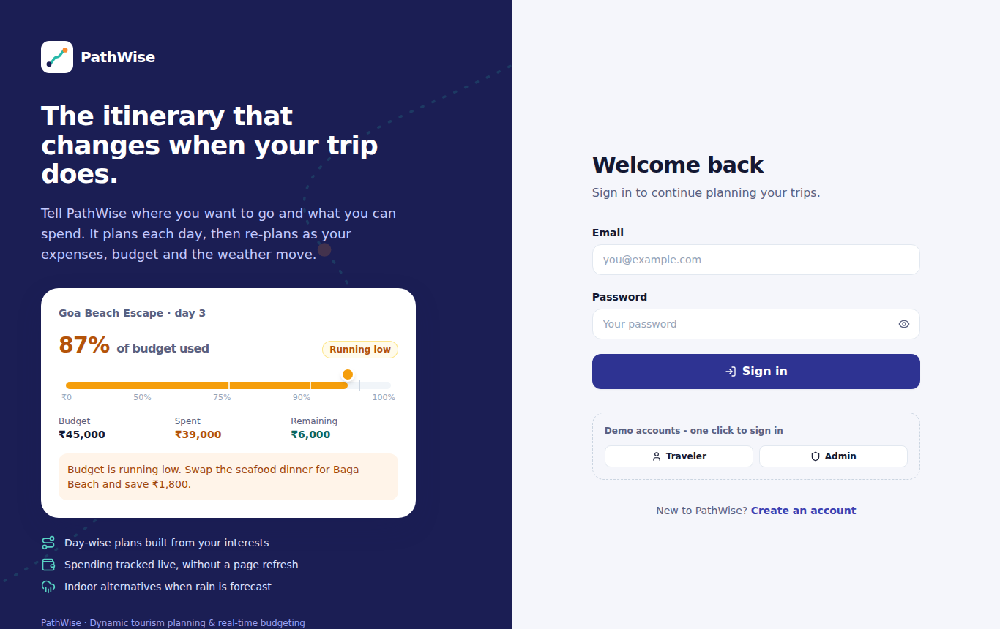 | 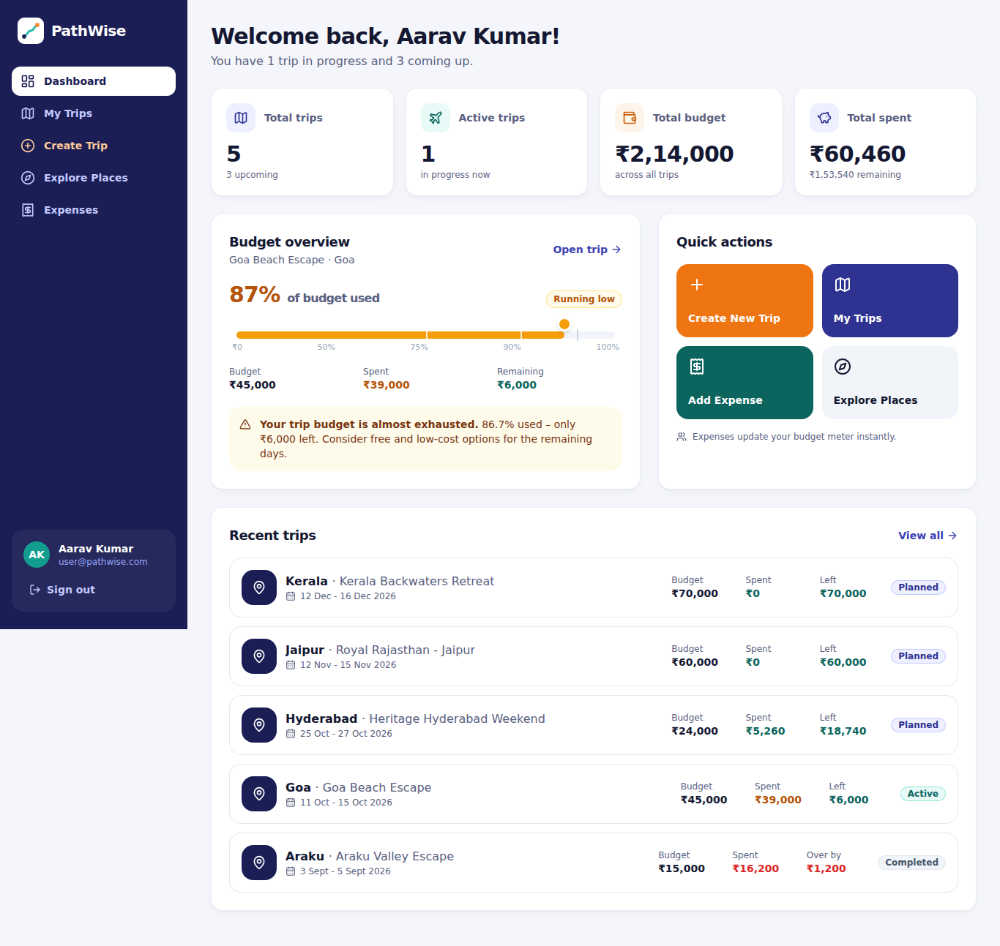 |
| 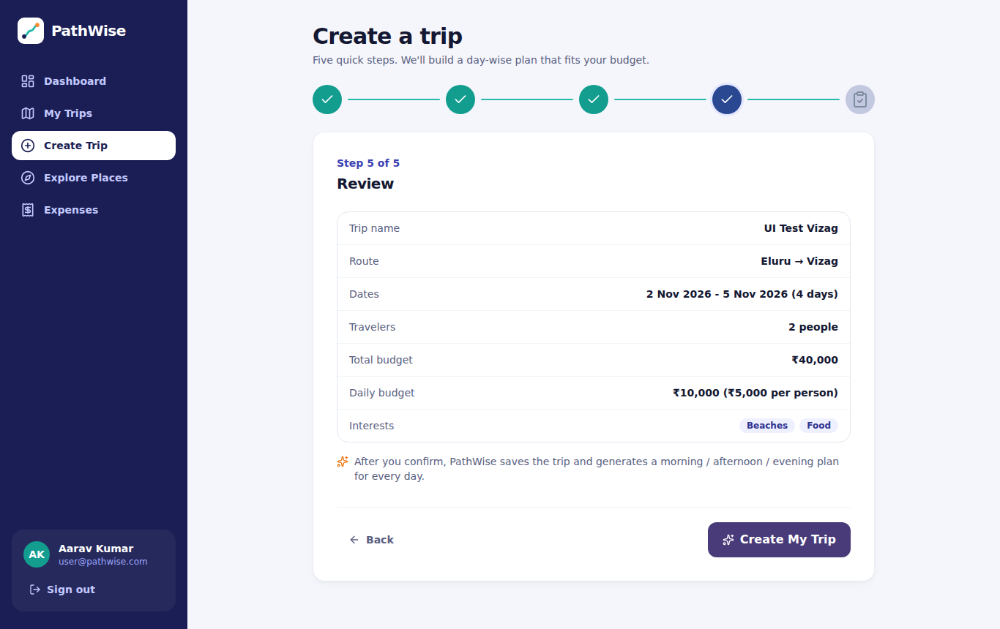 | 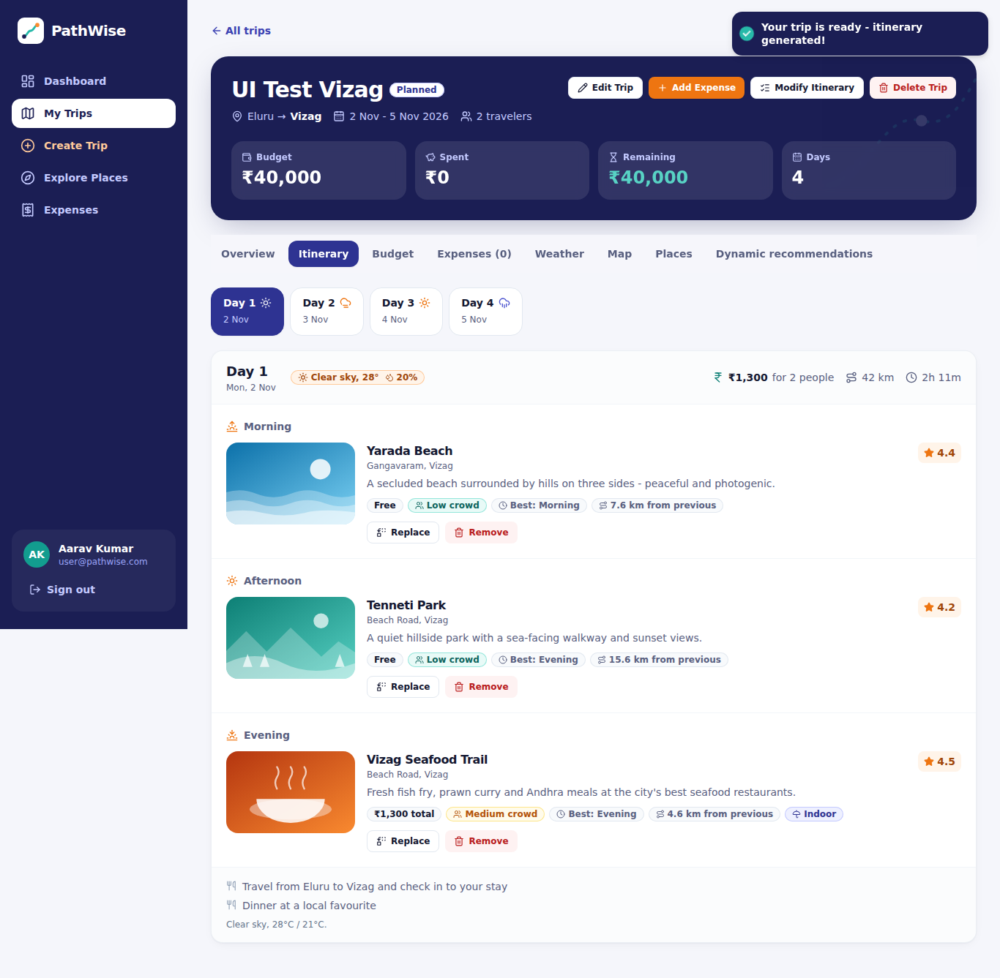 |
| 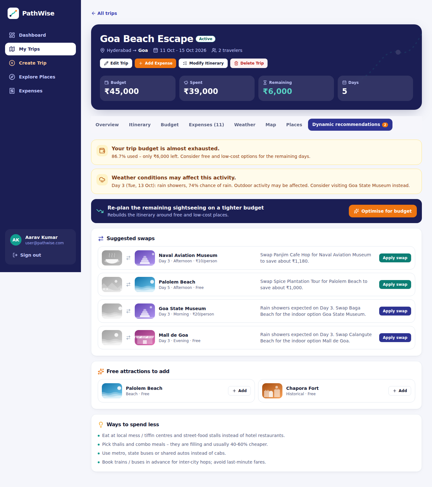 | 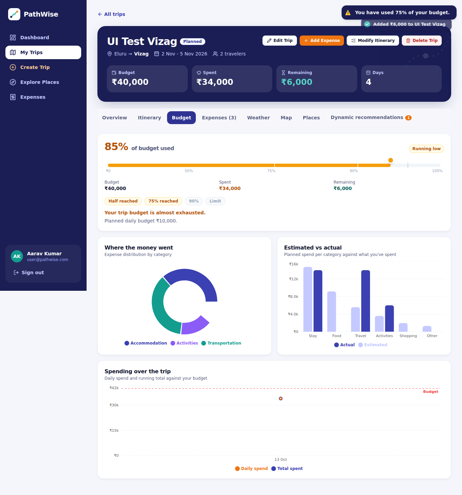 |
| 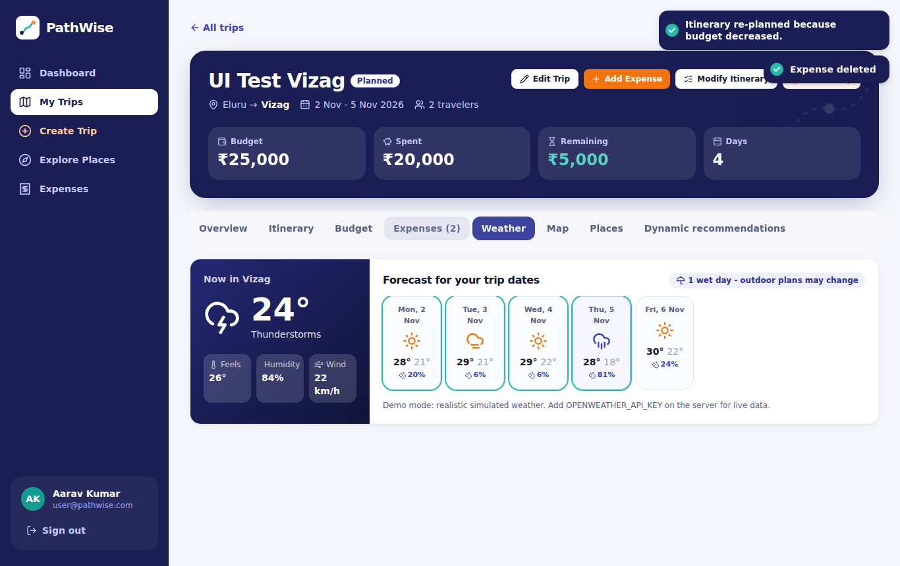 | 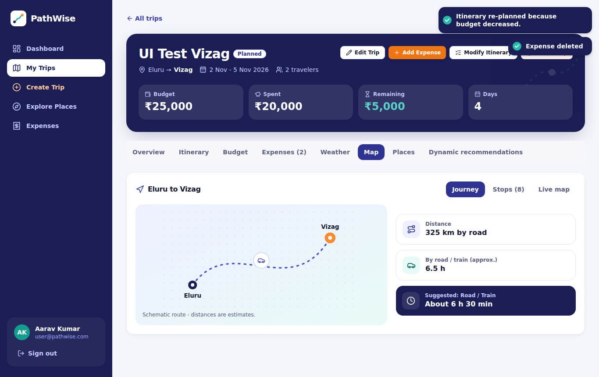 |
| 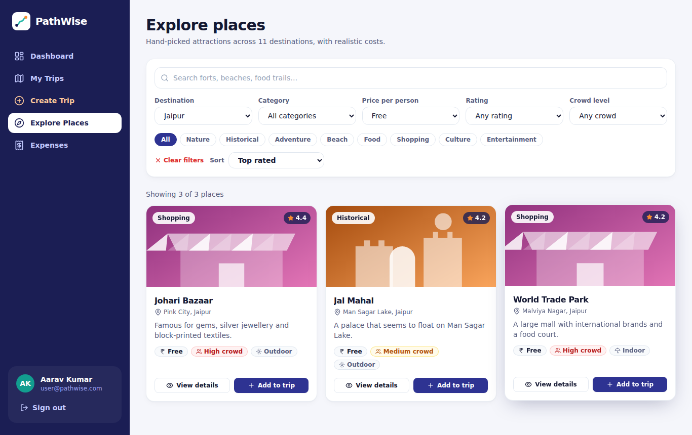 | 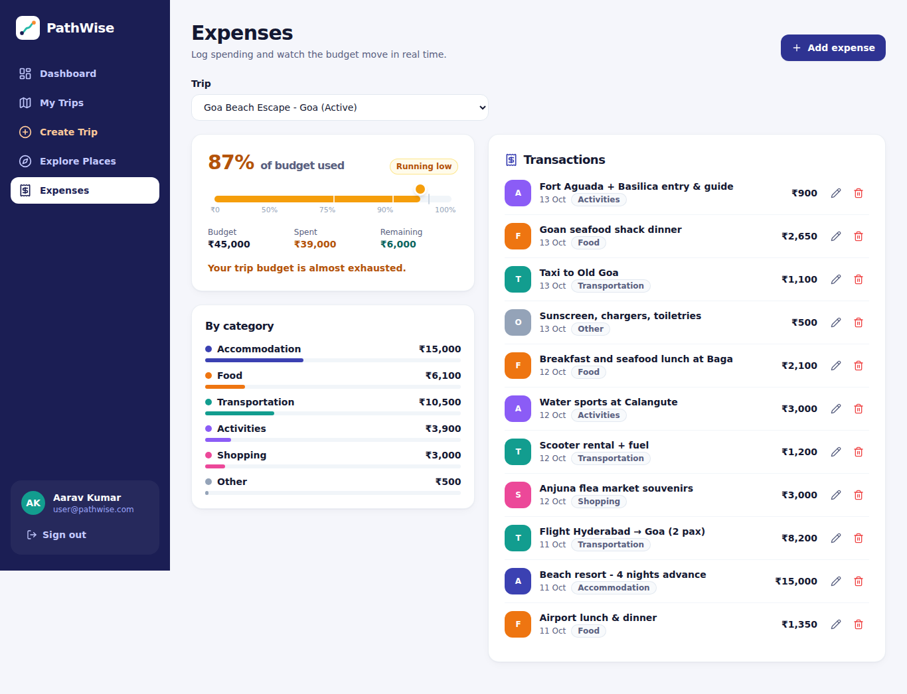 |
| 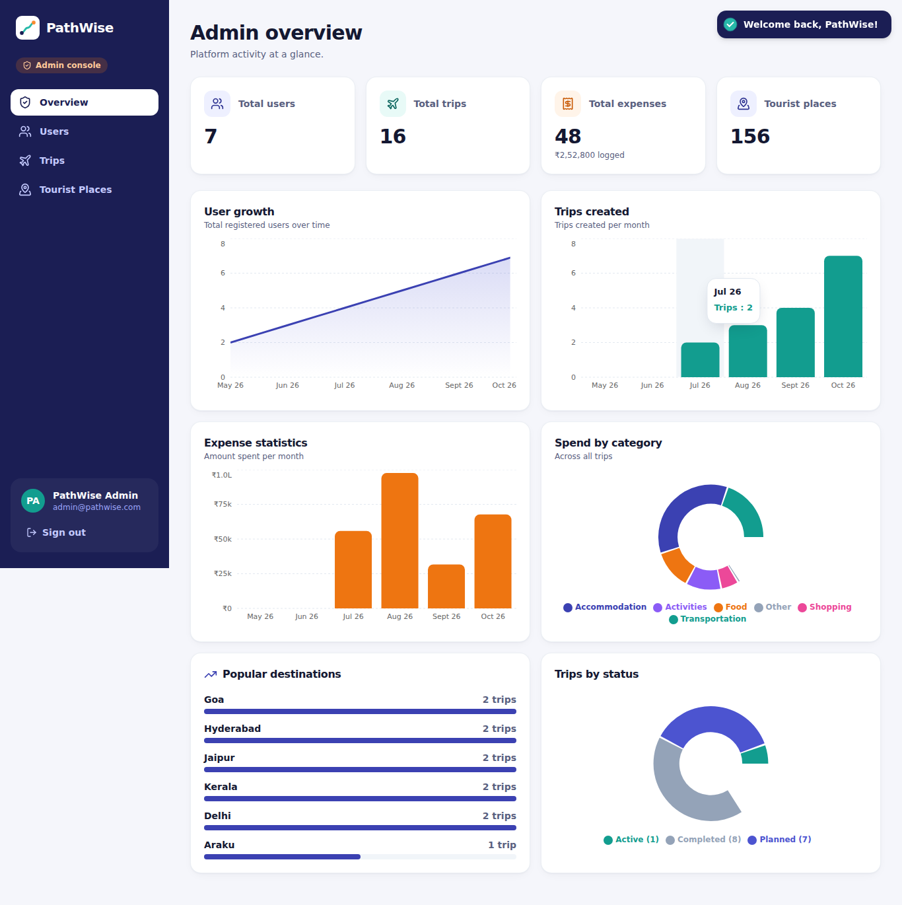 | 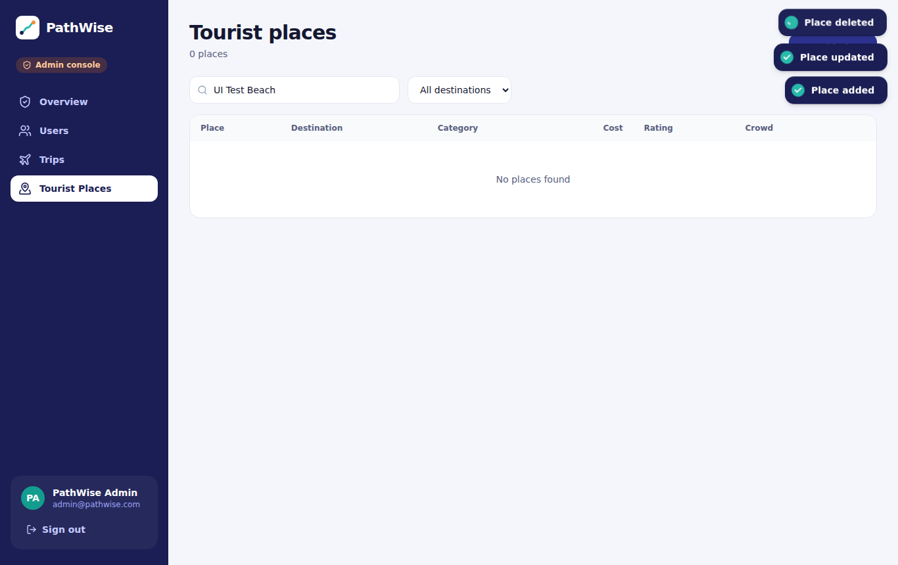 |
| 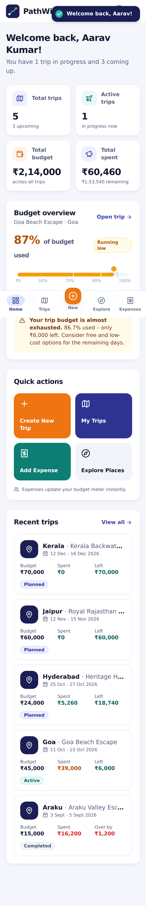 | 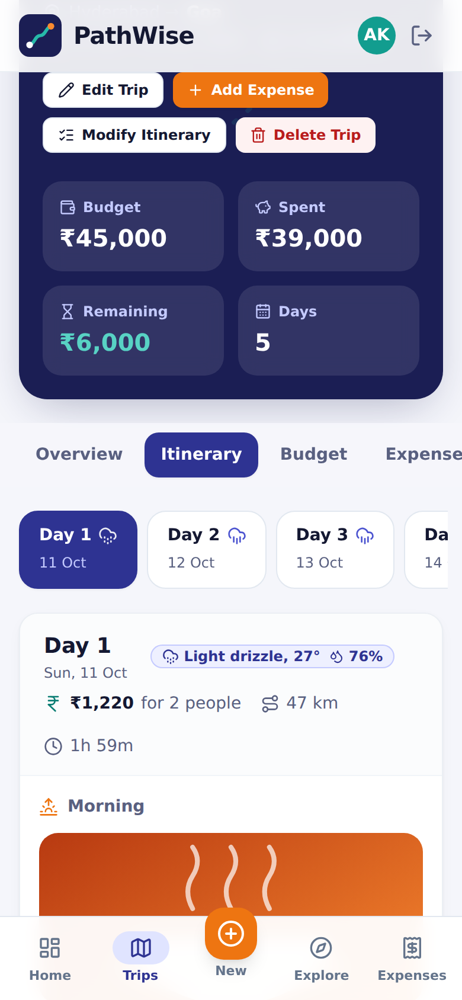 |

*(Screenshots were captured in an environment without access to Google Fonts, so they show the system fallback font; with internet the app uses Bricolage Grotesque + Figtree.)*

---

## 16. Future enhancements
- Real photos for places (Unsplash / Google Places Photos) and user-uploaded trip photos
- Live maps with turn-by-turn routes (Google Maps / Mapbox) and per-day route optimisation
- Booking integrations (hotels, trains, flights) with automatic expense import
- Group trips: shared itineraries, split expenses, voting on places
- Push / email notifications for budget thresholds and weather changes
- Multi-currency and receipt scanning (OCR) for expenses
- Learning-to-rank personalisation from accepted / rejected suggestions
- Offline PWA mode, i18n (Hindi, Telugu, Tamil), CI pipeline and component tests

## 17. Troubleshooting
| Symptom | Fix |
|---|---|
| `FATAL: JWT_SECRET is missing` | Create `server/.env` from `.env.example` and set a long random secret |
| `MongoDB connection failed` | Start MongoDB / `docker compose up -d`, check `MONGO_URI` (Atlas: allow your IP) |
| Login works but you are signed out on reload | Frontend and API on different origins: use the Vite proxy, or set `CLIENT_URL`, `COOKIE_SECURE=true`, `COOKIE_SAME_SITE=none` over HTTPS |
| Empty Explore page / no demo trips | Run `npm run seed` |
| Port already in use | Change `PORT` (server) or `--port` (Vite); update `VITE_PROXY_TARGET` if the API port changed |
| Fonts look different | Google Fonts need internet; the app falls back to system fonts |

License: MIT
